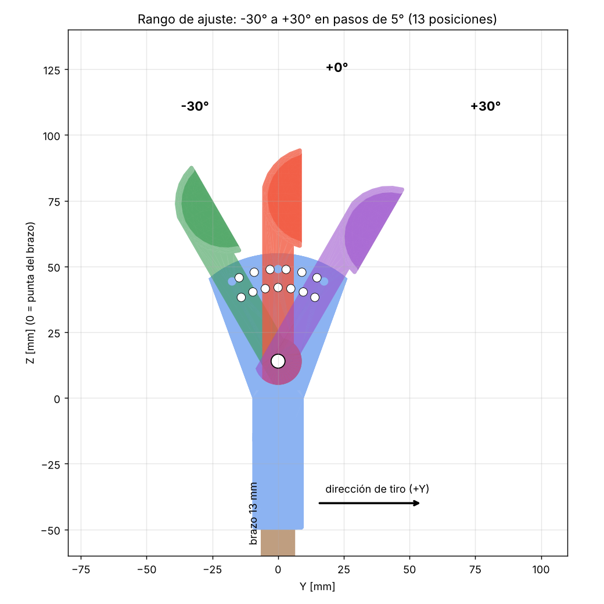

# Cuchara con ajuste de ángulo para la catapulta

Diseño para impresión 3D en PLA. Son dos piezas impresas más tornillería estándar:

| Pieza | Archivo STEP (abrir en Inventor) | Archivo STL (imprimir) |
|---|---|---|
| Soporte (manguito + orejas con agujeros de ángulo) | `step/soporte_cuchara.step` | `stl/soporte_cuchara.stl` |
| Cuchara (cuenco + tallo con pivote) | `step/cuchara.step` | `stl/cuchara.stl` |
| Ensamble de referencia (con trozo de brazo) | `step/ensamble_cuchara.step` | — |


## Cómo funciona

1. El **soporte** se mete en la punta del brazo como un capuchón y se **pega** con epoxi. El brazo **no se perfora**: está rajado y un agujero lo partiría. El manguito además abraza la rajadura y la mantiene cerrada.
2. La **cuchara** gira sobre un perno M5 (pivote) entre las dos orejas del soporte.
3. Las orejas tienen **13 agujeros de bloqueo** en dos filas. Un pasador M3 atraviesa las dos orejas y el tallo de la cuchara para trabar el ángulo.
   - Fila interior (R = 28 mm): −30°, −20°, −10°, 0°, +10°, +20°, +30°. Usa el agujero del tallo a 28 mm del pivote.
   - Fila exterior (R = 35 mm): −25°, −15°, −5°, +5°, +15°, +25°. Usa el agujero del tallo a 35 mm del pivote.
   - Resultado: **de −30° a +30° en pasos de 5°**. Las caras exteriores de las orejas llevan una marca grabada por posición; la de 0° es más ancha.



**Qué efecto tiene cada ángulo** (es la tendencia esperada; hay que confirmarla con disparos de prueba):

- **Negativo** (cuchara inclinada hacia atrás, con la boca mirando hacia afuera del brazo): la pelota sale antes durante el giro y el tiro es **más alto y parabólico**.
- **Positivo** (cuchara inclinada hacia la dirección de tiro): la pelota se retiene más tiempo y el tiro es **más bajo y tenso**.

> El soporte es simétrico: si el brazo gira hacia el otro lado, se gira el soporte 180° antes de fijarlo.

## Tornillería

| Uso | Elemento |
|---|---|
| Pivote de la cuchara | Tornillo M5 × 25 (o × 30 con mariposa) + tuerca mariposa o tuerca de seguridad (nyloc) |
| Pasador de ángulo | Tornillo M3 × 25 + tuerca, o varilla/clavo de 3 mm |
| Fijación al brazo | **Pegamento epóxico de 2 componentes** (ver "Pegado al brazo"). No se usa tornillo |

## Parámetros (para modelar en Inventor: *Administrar → Parámetros (fx)*)

| Parámetro | Valor | Descripción |
|---|---|---|
| `arm_x` | 13 mm | espesor del brazo en dirección del eje (**medido**) |
| `arm_y` | 13 mm | ancho del brazo en dirección de tiro (**POR CONFIRMAR**) |
| `clr` | 0.5 mm | holgura total (≈0.25 mm por lado para la capa de pegamento) |
| `wall` | 3 mm | pared del manguito |
| `sleeve_l` | 50 mm | profundidad del manguito (área de pegado) |
| `cap` | 3 mm | tapa del manguito |
| `vent_d` | 3 mm | respiraderos de pegamento, a 15 y 35 mm bajo la punta |
| `piv_d` | 5.3 mm | agujero del pivote (M5) |
| `pin_d` | 3.2 mm | agujeros de bloqueo (M3) |
| `stem_t` | 8 mm | espesor del tallo |
| `stem_w` | 12 mm | ancho del tallo |
| `hub_r` | 9 mm | radio del cubo del pivote |
| `gap` | stem_t + 0.6 = 8.6 mm | separación entre orejas |
| `r1` / `r2` | 28 / 35 mm | radios de las filas de agujeros |
| `cheek_r` | 41 mm | radio del sector de las orejas |
| `ball_d` | 30 mm | proyectil: bolita de plastilina de 20 g (≈29–30 mm) |
| `cup_ri` | ball_d/2 + 2 = 17 mm | radio interior del cuenco |
| `cup_wall` | 2.5 mm | pared del cuenco |
| `cup_depth` | 13 mm | profundidad interior del cuenco |
| `cup_dist` | 62 mm | distancia del pivote al centro del cuenco |

Valores derivados:

- Exterior del manguito: `arm_x + clr + 2·wall` = **19.5 mm** (igual en Y).
- Altura del pivote sobre la punta del brazo: `cap + 2 + hub_r` = **14 mm**.
- Espesor de cada oreja: `(19.5 − 8.6)/2` = **5.45 mm**.

## Paso a paso en Inventor

Ejes del modelo: **X** = dirección del eje de acero, **Y** = dirección de tiro, **Z** = a lo largo del brazo. La punta del brazo está en Z = 0.

### Pieza 1: Soporte (`soporte_cuchara.ipt`)

1. **Boceto en plano XY**: cuadrado de 19.5 × 19.5 centrado. Extruir **53 mm** hacia −Z (50 de manguito + 3 de tapa). Ubicar la cara superior en Z = +3.
2. **Cavidad**: en la cara inferior, cuadrado de 13.5 × 13.5 centrado. Extruir un corte de **50 mm** (queda la tapa de 3 mm arriba). Añadir un chaflán de 0.6 mm en la entrada.
3. **Orejas**: boceto en el plano YZ con este perfil:
   - Base de Y = −9.75 a +9.75 en Z = 0.
   - Dos líneas hasta (±26.35, 45.41).
   - Arco de **R41** con centro en (0, 14) que pasa por (0, 55).

   Extruir el perfil de X = 4.3 a X = 9.75, es decir **5.45 mm**. Hacer una simetría de esa extrusión respecto del plano YZ.
4. **Pivote**: agujero pasante de Ø5.3 en X, centrado en (Y 0, Z 14).
5. **Agujeros de bloqueo** (Ø3.2, pasantes en X). Centro de cada agujero en Y = r·sen(θ), Z = 14 + r·cos(θ):
   - Fila r = 28: θ = −30, −20, −10, 0, 10, 20, 30.
   - Fila r = 35: θ = −25, −15, −5, 5, 15, 25.

   Lo más cómodo es dibujar un agujero y usar un **patrón circular** con centro en el pivote: 7 instancias × 10° para la fila 1 y 6 instancias × 10° para la fila 2, empezando en −25°.
6. **Marcas** (opcional): ranuras de 0.7 × 0.6 mm de profundidad entre R38 y R41, cada 5°, en las dos caras exteriores.
7. **Respiraderos**: dos agujeros de Ø3 en dirección Y, en Z = −15 y Z = −35. Solo atraviesan las paredes del manguito. Por ahí sale el pegamento sobrante y queda como "remache".

### Pieza 2: Cuchara (`cuchara.ipt`)

Origen en el pivote. El tallo va hacia +Z y el cuenco abre hacia +Y.

1. **Cubo**: boceto en plano YZ, círculo de R9 en el origen. Extruir **8 mm** simétrico (X ±4).
2. **Tallo**: rectángulo en plano XY de 8 (X) × 12 (Y), centrado. Extruir de Z = 0 a Z = 62.
3. **Cuenco**:
   - Revolución o esfera de **R19.5** con centro en (Y 13, Z 62), unida al tallo.
   - Esfera de **R17** en el mismo centro, como **corte**.
   - Corte con plano en **Y = 9**: elimina todo lo que esté en Y > 9 y deja la boca del cuenco con 13 mm de profundidad y ≈33 mm de diámetro.
4. **Base plana**: corte de todo lo que esté en **Y < −6**. Esa cara es la que apoya en la cama de la impresora.
5. **Agujeros**: Ø5.3 en el origen (pivote) y dos de Ø3.2 en el tallo, a **Z = 28** y **Z = 35**, todos pasantes en X.
6. Redondeo de 0.8 mm en el borde del cuenco.

### Ensamble (`catapulta_cuchara.iam`)

1. Restricción **Insertar** entre el agujero de Ø5.3 de la cuchara y el del soporte.
2. Restricción **Simetría** (o Coincidente con offset) para que el tallo quede centrado entre las orejas: 0.3 mm de holgura por lado.
3. Restricción **Ángulo** entre el tallo y el eje Z del soporte, usando un parámetro `theta`. Así se puede mostrar cada posición de −30° a +30°.
4. Para el brazo: restricción Coincidente entre la cara interior de la tapa y la punta del brazo, y caras del brazo paralelas/centradas con la cavidad.

## Pegado al brazo

1. **Reparar la rajadura primero.** Meter cola blanca para madera o epoxi dentro de la grieta y apretar con una prensa o cinta. Dejar secar.
2. **Probar en seco.** El manguito debe entrar sin forzar hasta que la punta del brazo toque la tapa. Si entra muy justo, lijar un poco el brazo; no el manguito.
3. **Preparar las superficies.** Lijar con lija 120 el interior del manguito y la punta del brazo (las caras de MDF quemadas por el láser pegan mal). Limpiar el polvo.
4. **Pegar.** Usar **epoxi de 2 componentes** (tipo 5 o 10 minutos): untar el brazo y las paredes interiores, y meter el manguito girándolo un poco. El sobrante sale por los respiraderos.
5. **Alinear antes de que cure.** Las orejas deben quedar **paralelas al eje de giro** del brazo, para que la cuchara gire en el mismo plano que el brazo. Dejar curar 24 h antes de disparar.

> No usar silicona caliente: se despega con los golpes. El pegamento instantáneo (cianoacrilato) funciona, pero es frágil al impacto; el epoxi es mejor.

## Proyectil de plastilina (20 g)

- Una bolita de 20 g mide unos **29–30 mm**. El cuenco tiene 33 mm de boca y 13 mm de profundidad: es poco profundo para que la plastilina salga limpia.
- La plastilina se pega al PLA y eso cambia el punto de salida. Conviene **lijar suave el interior del cuenco**, o forrarlo con **cinta de embalaje** o ponerle una pizca de talco. Hay que usar siempre la misma preparación para que los tiros sean repetibles.
- Formar la bolita igual cada vez (misma masa y forma). Las diferencias de forma afectan más que 5° de ajuste.

## Impresión (PLA)

- **Capa**: 0.2 mm. **Paredes**: 4 perímetros. **Superior/inferior**: 5 capas. **Relleno**: 40–50 % giroide.
- **Soporte**: imprimir de pie, con la boca del manguito **hacia la cama**. No necesita soportes; la tapa de 13 mm se imprime como puente.
- **Cuchara**: imprimir acostada sobre su cara plana (Y = −6), con el cuenco **hacia arriba**. Activar soportes **solo desde la cama** bajo el cuenco.
- **Volumen** (sólido): soporte 29 cm³ y cuchara 12 cm³. Con el relleno indicado son unos 22 g + 9 g de PLA.
- Si los agujeros salen chicos, pasar una broca del diámetro nominal: 3, 4 y 5 mm.

## A tener en cuenta

- El centro del cuenco queda **76 mm por encima de la punta del brazo** y 13 mm adelantado. Con el brazo de 30 cm hasta el pivote, el radio efectivo es de unos **37.6 cm**. Si el radio total debe ser 30 cm, hay que acortar el brazo unos 7.5 cm.
- Para un ajuste fino del alcance conviene combinar esta cuchara con un **tope** que frene el brazo (barra transversal entre las placas laterales).

## Modelo paramétrico (código)

`cad/cuchara_ajustable.py` (CadQuery) regenera todos los STEP/STL. Se cambian los parámetros al inicio del archivo y se ejecuta:

```bash
pip install cadquery
python cad/cuchara_ajustable.py   # genera step/ y stl/ y verifica que no haya choques de -30° a +30°
python cad/render.py              # regenera las imágenes
```
